# MANUAL DO USUÁRIO ILUSTRADO
## SISTEMA DE GESTÃO ESTRATÉGICA – PGE-MA
### Guia Prático de Operação para Gestores (Chefias) e Integrantes (Subordinados)

---

## 1. INTRODUÇÃO E HISTÓRICO DE DESENVOLVIMENTO

### 1.1. Origem Tecnológica e Licença de Código Aberto (MIT)
O **Sistema de Gestão Estratégica da PGE-MA** teve sua base arquitetural construída a partir do projeto de software livre **Petrvs**, originalmente concebido pelo **Ministério da Gestão e da Inovação em Serviços Públicos (MGI)** do Governo Federal. 

Disponibilizado publicamente sob a **Licença MIT** (*Massachusetts Institute of Technology*), o código-fonte original assegura a liberdade para estudo, customização, aprimoramento contínuo e evolução independente por outros órgãos da administração pública.

### 1.2. Customização para o Cenário e Realidade da PGE-MA
Embora o núcleo técnico de multi-tenancy e microsserviços do Petrvs tenha servido de alicerce, a versão original era fortemente acoplada às regras do Programa de Gestão e Desempenho (PGD) da administração direta federal (Decreto Federal nº 11.072/2022 e Instruções Normativas federais nº 65/2020 e nº 24/2023).

Para atender à missão constitucional e às peculiaridades operacionais da advocacia pública estadual, a PGE-MA empreendeu um processo aprofundado de refatoração e adequação funcional:

1. **Expurgo de Resíduos Normativos Federais:**
   * Eliminação dos módulos de controle de frequência horária, teletrabalho no exterior por decreto federal e conceitos avaliativos rígidos da IN 24/2023 (notas conceituais Excelente/Regular), inaplicáveis às prerrogativas e à dinâmica dos Procuradores do Estado;
   * Supressão de nomenclaturas estranhas à cultura institucional estadual.

2. **Aderência ao Planejamento Estratégico da PGE-MA (Ciclo 2026–2030):**
   * Estruturação dos Eixos Temáticos, Objetivos Estratégicos e Resultados-Chave (KRs) aprovados pelo Gabinete;
   * Vinculação direta de todas as ações das 42 unidades (Especializadas, Regionais e Assessorias) ao mapa estratégico da instituição.

3. **Governança dos 10 Projetos Estruturantes (Grupos de Trabalho – GTs):**
   * Incorporação de painel executivo para acompanhar os 10 projetos estruturantes (como a *Força-Tarefa Profisco III / BID*, *Saneamento de RPVs e Precatórios pela PERJP*, *Integração PJe-SPA Delay Zero*, *Comitê Fiscal PDA/SEFAZ* e *Regimento Interno Único*).

4. **Instituição de Programas Contínuos:**
   * Adaptação do cadastro de regramentos para institucionalizar e medir a efetividade de programas transversais permanentes (a exemplo do *Programa Prazo Zero Perdido*).

5. **Integração Operacional com a Corregedoria-Geral:**
   * Módulo nativo para prestação de contas mensal da atividade finalística dos Procuradores (peças judiciais, audiências, pareceres e sustentações orais nos Tribunais) com fluxo ágil de homologação pelas chefias.

6. **Gestão Preventiva: Agenda de Marcos e Prazos:**
   * Criação de um centro de alertas na página inicial, sincronizando em tempo real as obrigações correcionais, prazos de ações e entregas críticas de cada unidade.

---

## 2. APRESENTAÇÃO E ACESSO

O sistema é disponibilizado via web corporativa, com acesso seguro e controle de permissões por perfil de lotação:

* **Gestor (Chefia / Procurador-Chefe / Diretor):** Gestão do Plano Setorial da unidade, distribuição de ações, acompanhamento da equipe, homologação de relatórios mensais e consulta aos Painéis Gerenciais.
* **Integrante (Procurador / Assessor / Servidor):** Registro de execução das ações sob sua responsabilidade, preenchimento do Relatório Mensal de Atividades e acompanhamento da sua agenda.

---

## 3. TELA INICIAL (HOME)

A tela inicial consolida a situação da unidade selecionada, fornecendo visão sintética da equipe e alertas executivos imediatos através da **Agenda de Marcos e Prazos**.

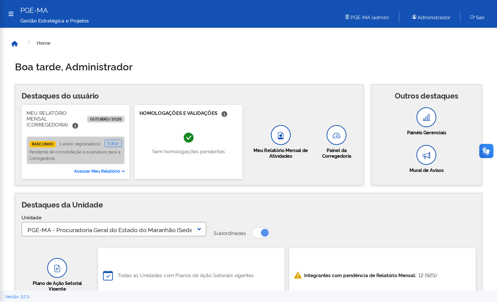

### 3.1. Seletor de Unidades e Chave "Subordinadas"
* **Seletor de Unidade:** Permite alternar entre a visão institucional da Sede (`PGE-MA`) e qualquer Especializada ou Regional específica (ex.: `PDA`, `PERJP`, `PRI`).
* **Chave "Subordinadas":** Quando **ativada** (padrão na Sede), agrega as métricas e membros de todas as 42 unidades subordinadas. Quando **desativada**, restringe as métricas estritamente ao setor imediato.

### 3.2. Cards de Resumo e Destaques
1. **Planos de Ação Vigentes:** Identifica se a unidade e suas vinculadas possuem planos homologados e ativos para o ciclo.
2. **Membros Regulares:** Mostra a regularidade cadastral e funcional dos integrantes na competência.
3. **Métricas Rápidas:** Apresenta o total de setores executores (42), membros lotados (13) e o volume consolidado de ações estratégicas (1.174).

### 3.3. Card de "Agenda de Marcos e Prazos"
Componente interativo que sincroniza em tempo real os prazos da unidade:
* **Filtros no Topo:**
  * **Todos:** Mostra todos os marcos cadastrados;
  * **Atenção:** Destaca compromissos vencidos e entregas iminentes (30 a 60 dias);
  * **Próximos:** Exibe o cronograma planejado de médio prazo.
* **Badges de Urgência:**
  * 🔴 **Vencido (Vermelho):** Prazos expirados que demandam regularização imediata;
  * 🟡 **A Vencer / Atenção (Amarelo):** Relatórios em rascunho ou entregas nos próximos 30–60 dias;
  * 🔵 **Planejado (Azul):** Marcos com execução no prazo regular.
* **Botão "Acessar":** Encaminha diretamente para o módulo correspondente (*Meu Relatório*, *Projetos Estruturantes* ou *Planejamento*).

---

## 4. MÓDULO DE PLANEJAMENTO

Localizado no menu lateral em **Gestão > Planejamento**. Permite a estruturação e consulta da base estratégica da PGE-MA.

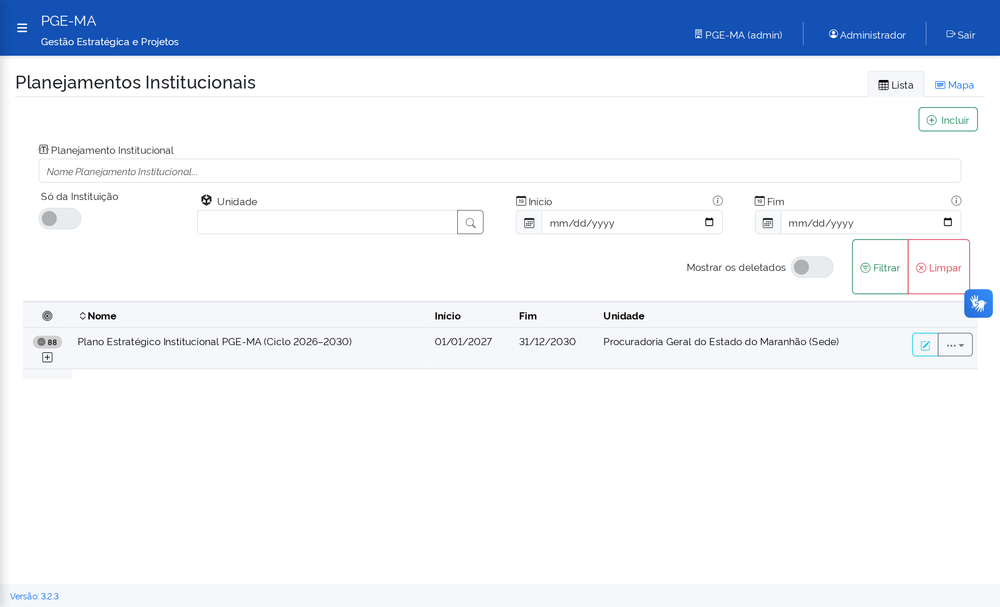

### 4.1. Planejamentos Institucionais
* **Finalidade:** Consulta e acompanhamento do macroplanejamento institucional (Ciclo 2026–2030).
* **O que o Gestor faz:** Visualiza as metas globais, indicadores de longo prazo, vigência e diretrizes aprovadas pelo Procurador-Geral.

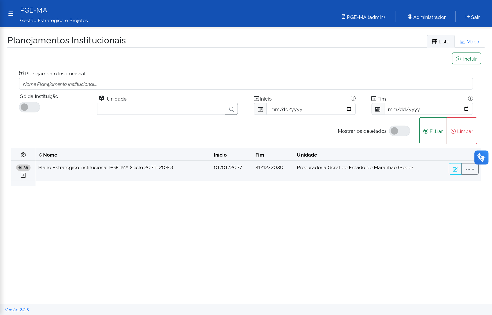

Ao abrir o registro do planejamento, o gestor tem acesso ao formulário com os objetivos e metas detalhadas:

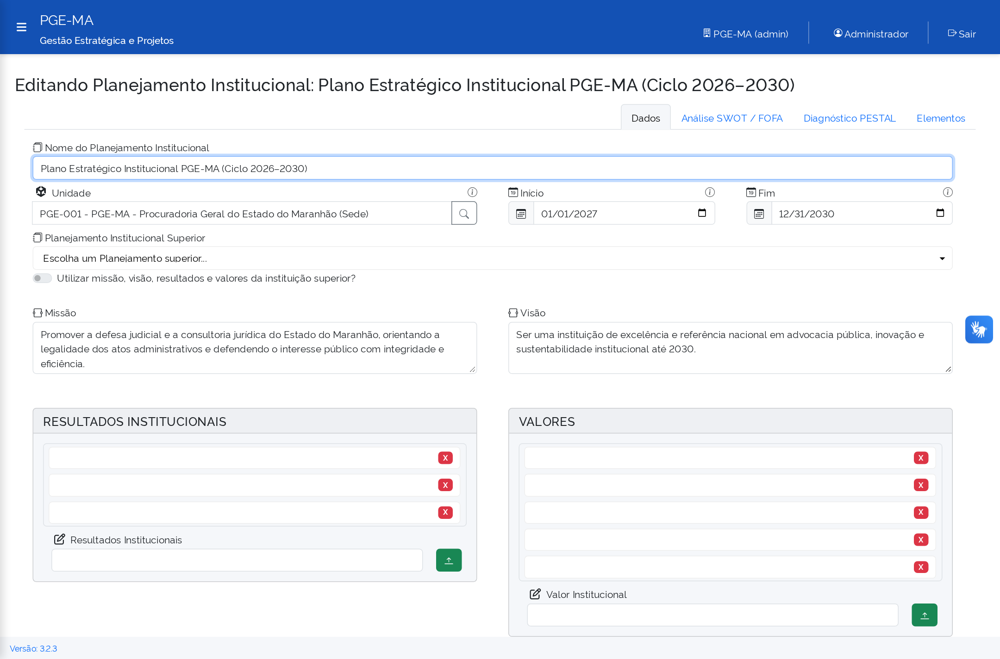

### 4.2. Regramentos Instituidores / Programas Contínuos
* **Finalidade:** Registro e acompanhamento da efetividade de **Programas Contínuos** da PGE-MA.
* **Exemplo Prático:** Cadastro do *Programa Prazo Zero Perdido*, agregando as portarias normativas, diretrizes de governança de prazos, iniciativas setoriais e eventos de capacitação vinculados à redução de perdas de prazo por procuradores.

### 4.3. Unidades Organizacionais
* **Finalidade:** Gestão da estrutura de Procuradorias Especializadas, Procuradorias Regionais, Órgãos Colegiados e Assessorias.
* **Operação:** Visualização hierárquica das 42 unidades, códigos organizacionais e vínculos de subordinação.

Ao clicar para editar ou consultar uma unidade, o formulário permite parametrizar sua sigla, nome oficial, unidade superior imediata e se atua como unidade instituidora/executora:

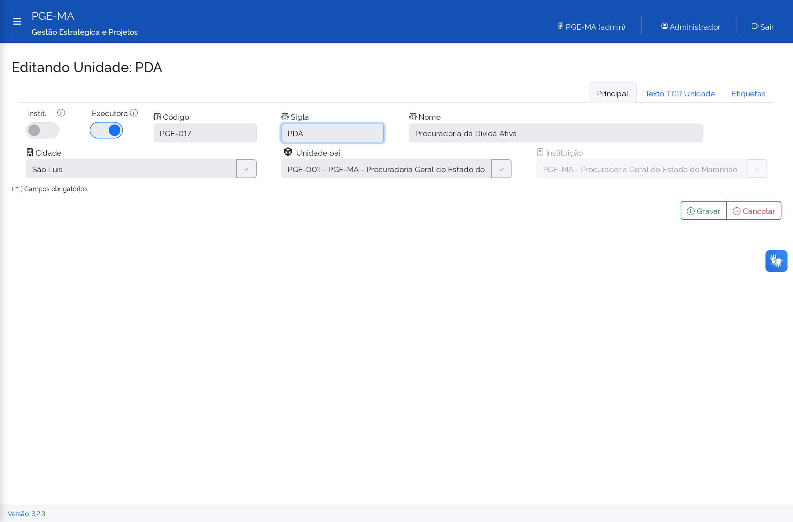

### 4.4. Agentes Públicos e Atribuições
* **Finalidade:** Gerenciamento dos Procuradores do Estado, Assessores Jurídicos e Servidores Administrativos vinculados à instituição.
* **Operação:** Consulta por nome, matrícula, e-mail institucional e lotação formal.

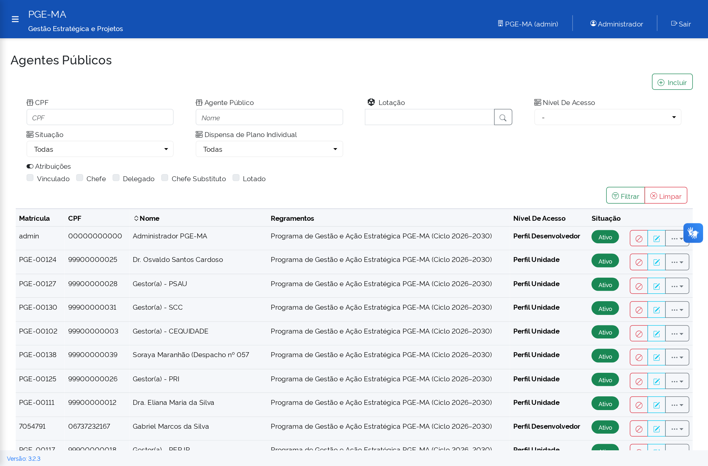

O formulário de agente público permite definir com precisão o perfil de acesso ao sistema (ex.: Administrador Geral, Chefia de Especializada, Membro) e a atribuição na unidade (Lotado, Colaborador ou Chefia Titular/Substituta):

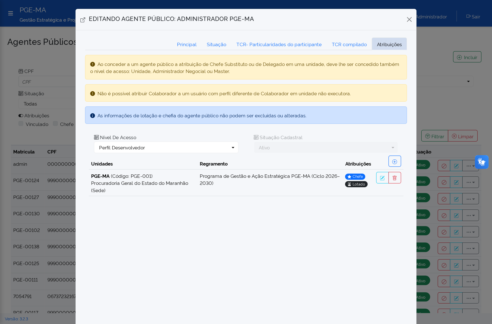

### 4.5. Eixos Temáticos e Elementos Estratégicos
* **Eixos Temáticos:** Grandes vertentes de atuação institucional (Gestão Fiscal e Receita, Modernização e TIC, Defesa do Patrimônio e Meio Ambiente, Pessoal e Previdência).
* **Elementos Estratégicos:** Objetivos Institucionais específicos aos quais todas as ações setoriais devem estar vinculadas para garantir o alinhamento estratégico.

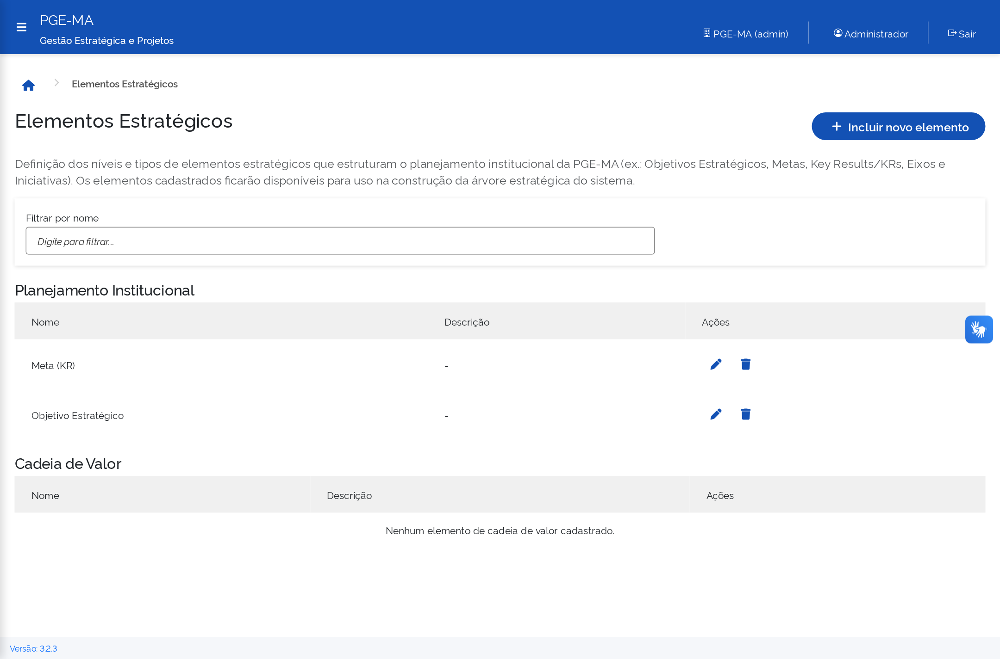

---

## 5. MÓDULO DE PLANOS DE AÇÃO SETORIAIS

Ambiente onde cada Chefia de Especializada e Regional planeja e acompanha as entregas da sua equipe.

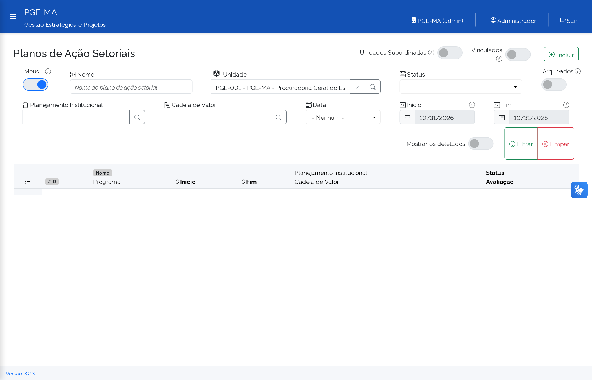

### 5.1. Passo a Passo para o Gestor (Chefia Imediata)
1. **Acessar o Módulo:** Navegue até **Gestão > Planos de Ação Setoriais**;
2. **Selecionar a Unidade:** Confirme se a sua unidade está selecionada no seletor superior;
3. **Cadastrar/Atualizar o Plano:** Clique em **"Novo Plano"** para o ciclo anual vigente ou acesse as ações do plano já aberto;
4. **Cadastrar Ações e Subações:**
   * Clique em **"Adicionar Ação"**;
   * Defina título claro e descrição do resultado esperado;
   * Vincule obrigatoriamente ao **Elemento Estratégico (Objetivo Institucional)** correspondente;
   * Indique o Procurador, Assessor ou Servidor nominalmente responsável;
   * Estabeleça a data-limite de entrega e unidades parceiras coexecutoras, se houver;
5. **Atualizar a Execução:** A cada 15 dias, atualize o status (**Não Iniciado**, **Em Andamento**, **Concluído**) e o percentual de avanço físico.

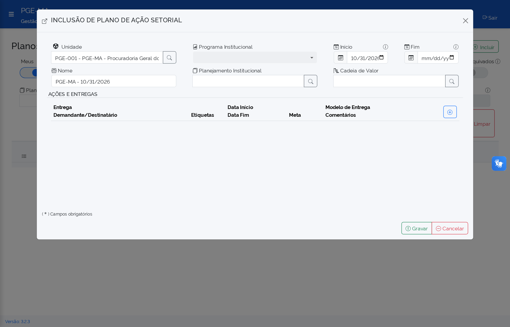

---

## 6. MÓDULO DA CORREGEDORIA (MEU RELATÓRIO)

Ambiente obrigatório para prestação de contas mensal das atividades judiciais e consultivas dos Procuradores do Estado.

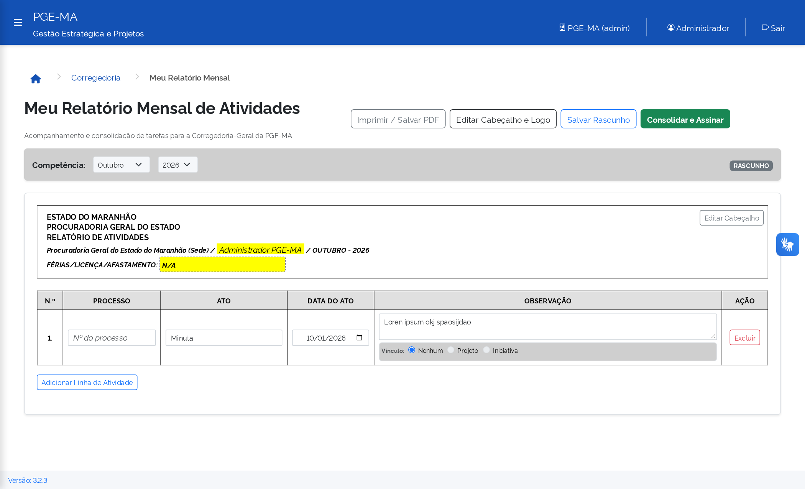

### 6.1. Para o Procurador (Preenchimento Mensal)
1. Acesse **Gestão > Corregedoria > Meu Relatório**;
2. Selecione a **Competência** desejada (mês de referência);
3. Preencha os quantitativos e registros qualitativos:
   * Peças judiciais elaboradas (contestações, apelações, agravos, impugnações, etc.);
   * Audiências acompanhadas (presenciais ou telepresenciais);
   * Sustentações orais perante os Tribunais (TJMA, TRT-16, TRF-1, STJ/STF);
   * Processos administrativos analisados e pareceres emitidos;
4. Revise os dados e clique em **"Enviar para Homologação da Chefia"** até o **5º dia útil** do mês subsequente.

### 6.2. Para a Chefia Imediata (Homologação)
1. Acesse **Gestão > Corregedoria > Homologação de Relatórios**;
2. Visualize os relatórios enviados pelos integrantes da unidade;
3. Homologue ou devolva para ajustes com justificativa fundamentada até o **10º dia útil**.

---

## 7. MÓDULO DE PAINÉIS GERENCIAIS

Disponível em **Gestão > Painéis Gerenciais**. Oferece visão executiva para tomada de decisão em três dimensões integradas:

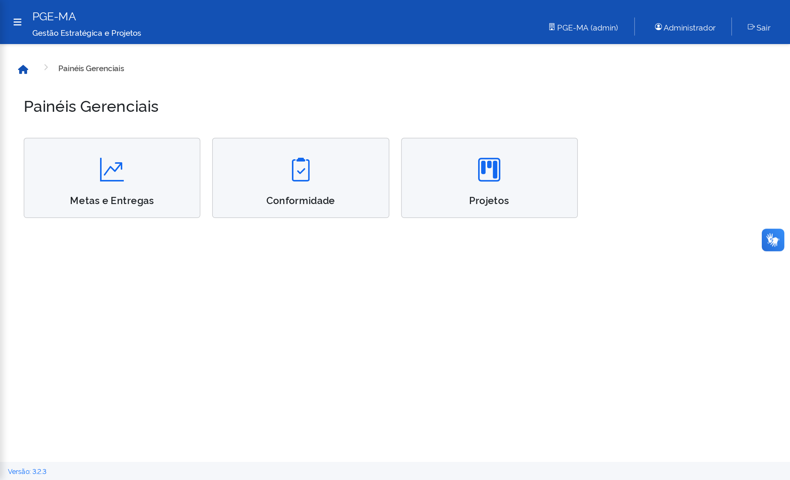

### 7.1. Painel 1: Metas e Entregas (`/metas-entregas`)
* **Gráficos de Barras Horizontais com Drill-Down:**
  * **Alinhamento Institucional:** Percentual de ações conectadas aos Objetivos Estratégicos 2026–2030 versus demandas rotineiras da própria unidade;
  * **Execução dos Planos Setoriais:** Proporção de ações concluídas, em andamento e pendentes por unidade;
  * **Execução das Atividades e Demandas Setoriais:** Volume de entregas da equipe;
* **Exportação em PDF:** Permite gerar relatórios executivos para reuniões de cúpula e colegiados.

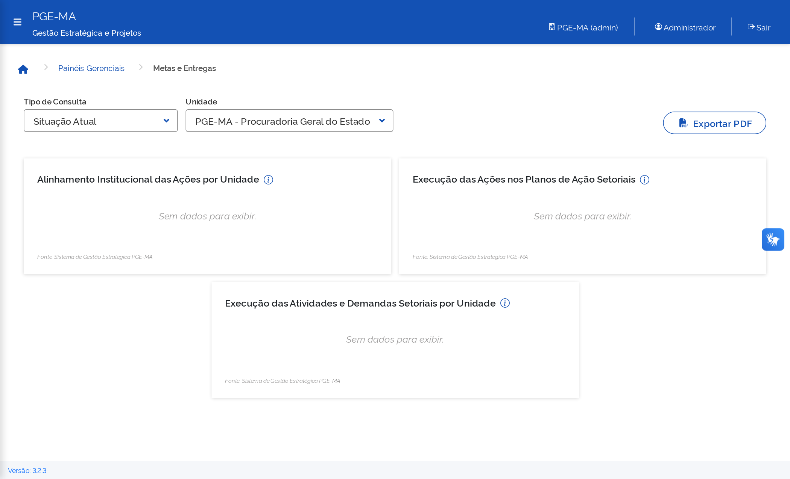

### 7.2. Painel 2: Conformidade (`/conformidade`)
* **Regularidade dos Relatórios Mensais:** Monitora o percentual de relatórios de atividades enviados no prazo, homologados e pendentes por unidade;
* **Planos de Ação Setoriais Vigentes:** Visão imediata de quais unidades possuem plano de ação ativo e quais estão sem plano no ciclo;
* **Cumprimento de Prazos das Ações:** Identificação ágil de ações no prazo versus cronogramas em atraso.

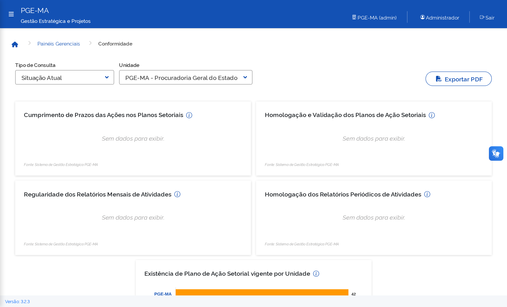

### 7.3. Painel 3: Projetos Estruturantes (`/projetos`)
* **Portfólio Executivo dos 10 Grupos de Trabalho (GTs):**
  * `[GT-01]` Força-Tarefa Profisco III / BID (10 Artefatos Estruturantes)
  * `[GT-02]` Grupo Técnico Permanente de Saneamento de RPVs e Precatórios
  * `[GT-03]` Comitê de Integração Fiscal e Recuperação de Créditos (PDA + NIRF + SEFAZ)
  * `[GT-04]` Estabilidade do SPA, Integração PJe-SPA (Delay Zero) e IA (MINUTIA)
  * `[GT-05]` Qualificação Recursal e Revezamento de Sustentações Orais
  * `[GT-06]` Regimento Interno Único e Governança Descentralizada de Prazos
  * `[GT-07]` Rede Institucional de Comunicação de Êxitos Judiciais e YouTube Tribunais
  * `[GT-08]` Integridade, Transparência Adaptada à LGPD e Enfrentamento ao Assédio
  * `[GT-09]` Integração Digital Descentralizada (Fórum Des. José Sarney)
  * `[GT-10]` Comitê Gestor do Plano Anual de Capacitação (PAC / ESAP)
* **Cards de Síntese:** Total de Projetos (10), Execução Prioritária, Implantação e Elaboração;
* **Filtros Rápidos:** Busca textual por código, título, líder ou KR, além de filtros por estágio;
* **Botão "Detalhes":** Direciona com um clique para a tela de detalhamento do projeto.

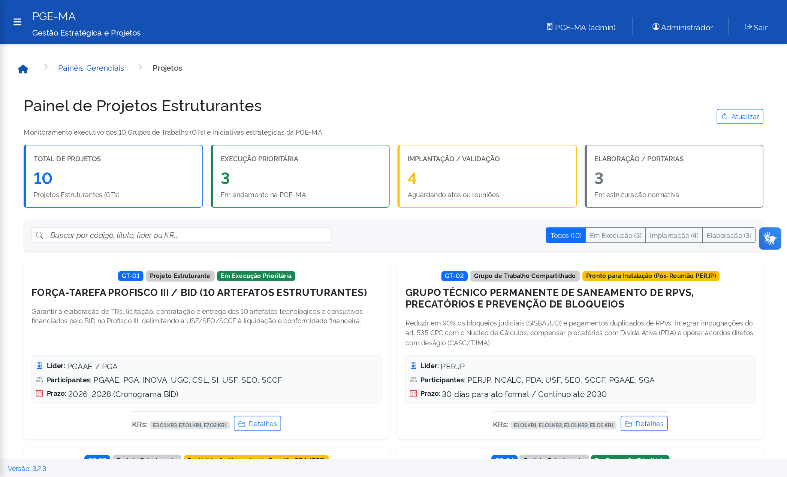

### 7.4. Preferências do Usuário e Personalização da Interface
Ao clicar no botão com o nome do usuário no canto superior direito e selecionar **"Preferências"**, o sistema abre o modal de configurações individuais:
* **Tema e Aparência:** Permite selecionar o tema de cores da interface, incluindo o **Azul Institucional (PGE-MA)** como padrão, além dos modos **Claro (Light)** e **Escuro (Dark)**.
* **Etiquetas Pessoais:** Criação e personalização de tags coloridas com ícones para organização visual de tarefas e ações.
* **Formas e Templates de Notificação:** Habilitação de alertas internos no sistema PGE-MA, e-mail e notificações automáticas de avaliações, comentários e conclusões de registros de execução.

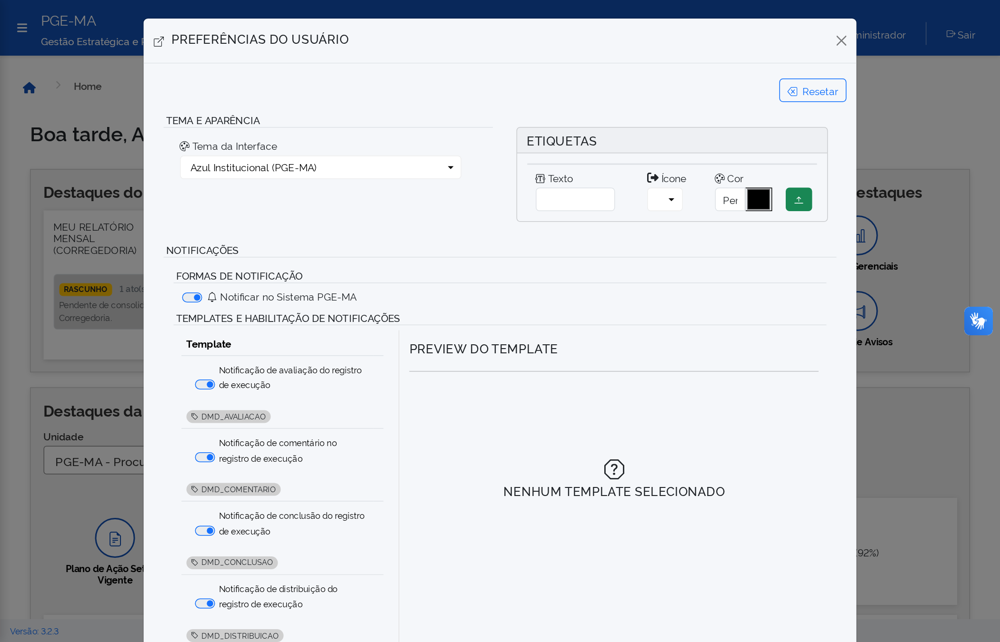

---

## 8. MATRIZ DE ROTINAS E RESPONSABILIDADES

| Frequência | Papel | Ação Obrigatória no Sistema | Módulo do Sistema |
| :--- | :--- | :--- | :--- |
| **Diária / Semanal** | Chefia Imediata | Acompanhar a *Agenda de Marcos e Prazos* na Home e atuar preventivamente em pendências. | `Home` |
| **Quinzenal** | Chefia / Responsável | Atualizar o percentual e status das ações em andamento no Plano Setorial. | `Planos Setoriais` |
| **Até 5º dia útil** | Procurador / Membro | Preencher e enviar o Relatório Mensal de Atividades da competência anterior. | `Corregedoria > Meu Relatório` |
| **Até 10º dia útil** | Chefia Imediata | Analisar e homologar os relatórios mensais dos integrantes da unidade. | `Corregedoria > Homologação` |
| **Mensal** | Gabinete / Chefias | Avaliar os Painéis de Metas, Conformidade e Projetos Estruturantes. | `Painéis Gerenciais` |
| **Anual** | Chefia Imediata | Instituir e homologar o novo ciclo do Plano de Ação Setorial da unidade. | `Planos Setoriais` |

---

## 9. SUPORTE E CONTATOS

* **Coordenação de Gestão Estratégica / Gabinete:** Dúvidas sobre o alinhamento aos Objetivos 2026–2030, Eixos e Programas Contínuos.
* **Corregedoria-Geral:** Orientações sobre o preenchimento dos relatórios mensais de atividades e prazos de homologação.
* **Assessoria de TIC:** Suporte técnico para perfis de acesso, senhas e integrações operacionais.
